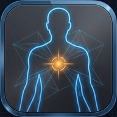
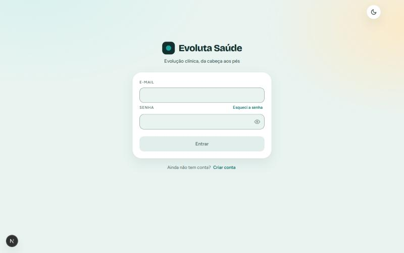

<p align="center">
  
</p>

<h1 align="center">Evoluta Saúde</h1>

<p align="center">
  <b>A anotação de enfermagem do CTI, montada a partir de um clique no corpo do paciente.</b><br>
  Você marca o que encontrou na silhueta. O Evoluta escreve o texto em ordem cefalocaudal,
  com a terminologia certa, pronto para colar no prontuário.
</p>

<p align="center">
  
  
  
  
  
  
</p>

<p align="center">
  <a href="https://evoluta-saude.vercel.app"><b>Abrir o Evoluta</b></a>
  &nbsp;·&nbsp;
  <a href="#o-problema">O problema</a>
  &nbsp;·&nbsp;
  <a href="#destaques">Destaques</a>
  &nbsp;·&nbsp;
  <a href="#tudo-o-que-ele-faz">Tudo o que ele faz</a>
  &nbsp;·&nbsp;
  <a href="#engenharia">Engenharia</a>
  &nbsp;·&nbsp;
  <a href="#quem-fez">Quem fez</a>
</p>

<p align="center">
  <picture>
    <source media="(prefers-color-scheme: dark)" srcset="docs/img/capa-escuro.jpg">
    
  </picture>
</p>

O Evoluta é uma aplicação web para enfermeiros de terapia intensiva. Em vez de digitar a evolução
do plantão do zero, a pessoa clica nas regiões do corpo do paciente (pupilas, vias aéreas, acessos,
sondas, drenos, pele, infusões...), responde a um formulário curto e específico daquele achado, e
o texto final sai pronto, sempre na mesma ordem e sem erro de digitação. Funciona no computador do
posto e no celular, no meio do plantão.

> Esta é a página de apresentação do Evoluta. O código-fonte fica num repositório privado
> (veja [Sobre o código](#sobre-o-código)).

## O problema

Num CTI, cada paciente gera várias anotações por dia, e todas seguem a mesma lógica: examinar da
cabeça aos pés e registrar tudo em texto corrido. Na prática, isso significa:

- **Tempo de beira de leito gasto digitando** a mesma estrutura de frase, plantão após plantão.
- **Ordem trocada e itens esquecidos** quando o exame não acontece na ordem em que se escreve.
- **Erros que importam**: taxa de infusão incompleta, lateralidade faltando, termo técnico errado.

O Evoluta trata a anotação como **dado estruturado**, não como texto. O texto é só a saída: gerado
a partir do estado do exame, ele não tem como sair fora de ordem ou com campo pela metade.

## Destaques

<table>
  <tr>
    <td width="50%" valign="top">
      <b>🧍 Silhueta clicável, frente e costas.</b><br>
      Cada região do corpo é uma área de toque que abre o formulário certo para aquele achado,
      com mira e lupa para acertar regiões pequenas no celular.
    </td>
    <td width="50%" valign="top">
      <b>📝 Texto em ordem cefalocaudal, sempre.</b><br>
      Não importa a ordem em que você preenche: a anotação sai da cabeça aos pés, com frases
      vizinhas fundidas de forma natural.
    </td>
  </tr>
  <tr>
    <td width="50%" valign="top">
      <b>💉 Infusões organizadas por via.</b><br>
      Drogas agrupadas em cards por acesso, com um campo de busca alimentado por uma biblioteca
      de medicamentos de CTI e espaço para texto livre.
    </td>
    <td width="50%" valign="top">
      <b>🛏️ Vários leitos no mesmo plantão.</b><br>
      Até três anotações abertas ao mesmo tempo, salvas na nuvem enquanto você preenche, para
      alternar entre pacientes sem perder nada.
    </td>
  </tr>
  <tr>
    <td width="50%" valign="top">
      <b>🔒 Pensado para dado de saúde.</b><br>
      Isolamento por usuário no próprio banco (RLS), leito identificado só por número, sessão que
      expira por inatividade e páginas de privacidade e termos.
    </td>
    <td width="50%" valign="top">
      <b>📱 Feito para o plantão real.</b><br>
      Instalável como app (PWA), tema claro e escuro, e ajustado para iPhone e Android: sem zoom
      indesejado nos campos e sem texto inchando ao girar a tela.
    </td>
  </tr>
</table>

## Por que o Evoluta

- **Domínio clínico de verdade.** Cada formulário segue como a enfermagem de CTI registra: Glasgow
  e RASS, tamanho e reatividade das pupilas, P.A.I. por local, lesão por pressão por estágio, queimaduras com
  cálculo da superfície corporal queimada (SCQ), ostomias, drenos e sondas com débito e aspecto.
- **O texto nunca é digitado.** Ele é derivado do estado estruturado
  (`noteBuilder.ts`): elimina erro de acentuação, taxa incompleta e
  ordem trocada por construção, não por revisão.
- **Segurança no banco, não só na tela.** A chave pública do Supabase vai para o navegador, então
  o limite de anotações e o acesso a cada linha são garantidos por trigger e políticas de RLS no
  Postgres (`schema.sql`). Nenhuma regra depende de alguém usar a interface.
- **Coleta mínima de dado de paciente.** O nome da anotação aceita só o número do leito, para que
  ninguém digite nome de paciente ali por hábito.
- **Testado.** Mais de 60 arquivos de teste cobrem as regras clínicas (ordem cefalocaudal, pupilas,
  sondas, queimaduras, P.A.I.) e o comportamento da interface no celular.

## Tudo o que ele faz

<details>
<summary><b>Exame físico guiado</b></summary>

- **Silhueta anterior e posterior**, com áreas de toque por região e uma mira que mostra onde o
  toque vai cair antes de confirmar.
- **Dados do leito e monitorização**: horário do registro, decúbito, grades, cabeceira e
  monitorização contínua.
- **Cabeça e pescoço**: pupilas por lado (tamanho pelo diâmetro, reatividade, incluindo
  bradirreagente), vias aéreas e dispositivos cervicais em cards.
- **Tórax e abdome**: acessos, drenos (Portovac, Blake, Kehr, Penrose, tubular), incisões,
  ostomias e sondas enterais, com débito, aspecto e permeabilidade.
- **Pelve e membros**: eliminações, sonda vesical, pele, procedimentos e P.A.I. (radial, femoral,
  pediosa, braquial, tibial posterior), com a posição marcada no texto e na silhueta.
- **Pele**: lesão por pressão por estágio e queimaduras com SCQ somada das duas vistas.
- **"Imensurável / não avaliável"** com motivo, para quando o exame não é possível.
- **Dispositivos fora do catálogo**: um item livre pode ser posicionado em qualquer ponto do corpo,
  e a posição do clique define onde ele entra no texto.

</details>

<details>
<summary><b>Infusões</b></summary>

- **Cards por via de acesso**, cada um com suas drogas.
- **Campo Droga com busca**, alimentado por uma biblioteca de medicamentos de uso comum em CTI, e
  texto livre para o que não estiver na lista.

</details>

<details>
<summary><b>Plantão e anotações</b></summary>

- **Até três anotações abertas**, uma por leito, em abas.
- **Salvamento automático na nuvem**, enviando só o que mudou, com indicador de sincronização.
- **Texto pronto para copiar** no prontuário, com horário.
- **Tour de primeiro acesso** para quem nunca usou.

</details>

<details>
<summary><b>Conta, segurança e privacidade</b></summary>

- **Cadastro com confirmação por e-mail**, recuperação e troca de senha, com e-mails próprios
  do Evoluta.
- **Sessão que expira** após 45 minutos sem uso, pensando no computador compartilhado do posto.
- **Rotas protegidas no servidor**, com limite de tempo na validação da sessão: se o serviço de
  autenticação demorar, a pessoa cai no login em vez de ver uma página quebrada.
- **Políticas de privacidade e termos de uso**, e uma página de contato que envia a mensagem
  por e-mail.

</details>

## Engenharia

| Camada | Escolha |
| --- | --- |
| Front-end | Next.js 16 (App Router), React 19, TypeScript |
| Estado | `useReducer` com estado clínico tipado, sem biblioteca externa |
| Estilo | CSS com custom properties (tema claro e escuro), IBM Plex via `next/font/local` |
| Back-end | Supabase: Auth, Postgres, Row Level Security e trigger de limite |
| Testes | Vitest + Testing Library + jsdom |
| Deploy | Vercel, com deploy contínuo a partir da `main` |

**Arquitetura em uma frase:** o exame é um estado estruturado por região
(`types.ts`, `regions.ts`); cada região sabe se
descrever e qual a sua posição no corpo; o `noteBuilder` ordena e funde
essas descrições no texto final. A interface só edita o estado.

```
src/
├── app/            rotas (auth, área interna, páginas legais, API de contato)
├── components/     silhueta, painéis de formulário, cards por região, conta
├── hooks/          rascunhos, rolagem, painel, avisos
└── lib/            regras clínicas, catálogos, gerador do texto, sincronização
supabase/
└── schema.sql      tabela, RLS e trigger
```

### Sobre o código

O código-fonte do Evoluta fica num repositório privado. Este repositório é a página de
apresentação dele. Para uma avaliação técnica (leitura do código,
conversa sobre arquitetura ou um tour pela aplicação), é só entrar em contato.

## Quem fez

<table>
  <tr>
    <td>
      Sou <b>Vitória Cardozo</b>, desenvolvedora focada em <b>tecnologia para a saúde</b>. O Evoluta
      é o meu projeto principal: desenhei e construí do zero, da regra clínica de cada formulário ao
      banco de dados, à autenticação e ao deploy, com mais de 480 commits desde agosto de 2026.
      <br><br>
      Procuro oportunidades em healthtechs, hospitais e empresas de software para a saúde.
      <br><br>
      <a href="https://github.com/vitoriacardozo20">GitHub</a>
      &nbsp;·&nbsp;
      <a href="https://evoluta-saude.vercel.app/contato">Contato pelo Evoluta</a>
    </td>
  </tr>
</table>

---

<sub>O Evoluta é uma ferramenta de apoio ao registro. Ele não substitui o julgamento clínico, e a
anotação final é sempre revisada e assinada por quem a fez.</sub>
